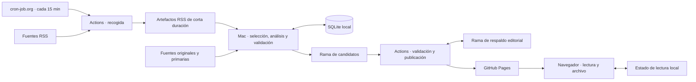

# Talaia — Arquitectura de V1

**Estado:** propuesta técnica para revisión · 10 de noviembre de 2026  
**Alcance de producto:** [REQUIREMENTS.md](REQUIREMENTS.md)  
**Entorno de referencia:** [etroitino/talaia, rama main](https://github.com/etroitino/talaia/tree/main)

## 1. Diseño general

Talaia mantiene Python para los procesos y HTML, CSS y JavaScript para la web estática. GitHub Actions recoge RSS y publica en Pages. El Mac prepara el contenido editorial con IA local, guarda su estado de trabajo en SQLite y entrega un lote validado a GitHub. El navegador consulta los datos publicados y conserva únicamente su estado de lectura.

| Componente | Responsabilidad y límite |
| --- | --- |
| Recogida en GitHub | Leer el catálogo autorizado, normalizar enlaces, deduplicar dentro del lote y registrar disponibilidad por fuente. Genera capturas sin IA y sin desplegar Pages. |
| Procesamiento en el Mac | Importar y deduplicar capturas, agrupar acontecimientos, seleccionar la edición, verificar y redactar con IA, relacionar historias y preparar novedades y rectificaciones. Un único proceso local escribe el estado. |
| Publicación en GitHub | Validar el lote contra el último estado publicado, construir el sitio completo, respaldar el estado editorial y desplegar. Es la única vía de publicación pública. |
| Navegador | Mostrar edición, detalle, novedades, historias, Explorar, archivo y diagnóstico. Buscar por palabras en un índice estático y conservar localmente qué elementos se han abierto. |

Las interfaces entre componentes son archivos versionados. Los procesos de trabajo y despliegue tienen responsabilidades distintas y pueden compartir los validadores Python. El Mac y GitHub pueden reanudar su parte sin que Pages tenga que comunicarse con el ordenador.

## 2. Recogida y procesamiento

### Capturas RSS

Un workflow de recogida obtiene los RSS de `fuentes.yaml`. Lo lanza cron-job.org; el horario nativo de GitHub queda como respaldo y también se puede ejecutar a mano. Emite un lote comprimido por ejecución con un manifiesto, intervalo de recogida, estado por fuente y metadatos mínimos por artículo. El fallo de una fuente queda registrado y el lote conserva las entradas válidas de las demás. Las capturas caducan como artefactos de Actions, con retención de siete días por ejecución. Al importarlas, el Mac aplica además una ventana móvil de siete días por entrada, porque la fecha de una entrada y la del artefacto pueden diferir. La ventana del producto es lógica. El borrado físico del artefacto depende de GitHub y no ocurre por artículo.

El Mac descarga los artefactos disponibles de ejecuciones válidas del workflow de recogida. Importa con una clave de artículo estable y conserva el último intervalo importado y los intervalos que faltan. Si un lote ha caducado o faltan ejecuciones, el diagnóstico distingue falta de cobertura de ausencia de noticias. Solo se guardan titulares, enlaces, fechas, identificación de fuente y metadatos necesarios. En el repositorio público, también se tratan las capturas y los artefactos como material público.

**Disparador (decisión tras la fase 0).** Se mantiene cron-job.org como disparador de la recogida, cada 15 minutos por `workflow_dispatch` con un token limitado al repositorio y a Actions, y el horario nativo de GitHub queda como respaldo. Del 27 de octubre al 10 de noviembre de 2026 el horario nativo produjo 4,3 ejecuciones al día en vez de 96, con huecos de 5,9 h de mediana y 10,5 h como máximo. Algunos RSS solo cubren 2,6 h (ABC) o 4,5 h (Diari de Girona), así que esos huecos perderían entradas. No es un servicio nuevo: es el disparador que ya usa Talaia. Mientras convivan, cada ejecución de `recoger.yml` lanzada por cron-job.org dispara también la recogida de V1 (`workflow_run`), sin cambiar ese workflow ni el destino de cron-job.org. En el corte (fase 6), cron-job.org pasa a lanzar directamente la recogida de V1. El importador sigue tratando como lagunas los intervalos que ningún lote cubra, sea cual sea el disparador. [Eventos programados de GitHub Actions](https://docs.github.com/en/actions/reference/workflows-and-actions/events-that-trigger-workflows#schedule) · [Retención por artefacto en GitHub Actions](https://docs.github.com/en/actions/tutorials/store-and-share-data#configuring-a-custom-artifact-retention-period)

### Procesamiento en el Mac

Un agente de usuario de `launchd` ejecuta el mismo comando al iniciar sesión y en las ventanas objetivo de 07:00, 13:00 y 19:00. Para respetar la hora peninsular incluso cuando cambie la zona del Mac, un disparador periódico de baja frecuencia comprueba qué ventana vence según `Europe/Madrid`. El disparador comprueba el estado y termina si no hay trabajo. El agente requiere una sesión de usuario. Al despertar, iniciar sesión o recuperar conectividad, la primera ejecución disponible vuelve a evaluar el estado. La ejecución manual utiliza las mismas reglas de exclusión y validación. [Programación y suspensión en macOS](https://developer.apple.com/library/archive/documentation/MacOSX/Conceptual/BPSystemStartup/Chapters/ScheduledJobs.html)

Cada ejecución obtiene un bloqueo local y opera con una fecha editorial de Madrid y un corte de capturas explícitos. Consulta primero si la edición del día está publicada o pendiente de publicación. Si falta después de las 07:00, prepara solo la edición actual. Si ya existe, procesa las revisiones pendientes pertinentes y las rectificaciones, sin recrear la edición. Los días sin edición se señalan en el archivo. Las marcas de tiempo de fuentes y procesos se almacenan con zona explícita, normalizadas a UTC para comparación.

El procesamiento prioriza las rectificaciones importantes, la edición y las novedades sobre Explorar. El agrupador propone candidatos por similitud y señales temporales. La preselección aplica reglas explícitas y la IA prioriza impacto y trascendencia, con diversidad flexible, cobertura como señal secundaria y preferencias editoriales explícitas. La configuración de temas y territorios reside en un único archivo mantenido por el responsable editorial y leído por el Mac. La agrupación recalculada de una ventana alimenta relaciones persistentes de artículos, acontecimientos e historias. Una reasignación de grupo no cambia los identificadores ya publicados.

### Análisis y evidencias

- **Recuperación de fuentes.** Un proceso acotado obtiene documentos admisibles para afirmaciones concretas. Distingue fecha de publicación y fecha del dato, atribuye la procedencia e identifica reproducciones de una misma fuente. Respeta restricciones de acceso y trata el contenido recuperado como datos. El modelo recibe referencias y fragmentos autorizados, sin control sobre la red, los secretos o el despliegue.
- **Salida estructurada.** El modelo devuelve hechos, interpretaciones, cuestiones abiertas y referencias por afirmación. La validación comprueba esquema, integridad de referencias y citas literales cuando haya texto accesible. La evaluación editorial comprueba además que la evidencia respalda la afirmación. Un esquema válido por sí solo no acredita el contraste.
- **Degradación.** El resultado puede ser completo, parcial con limitaciones, o titulares y enlaces. Si una selección válida cumple el mínimo de publicación, los análisis parciales se etiquetan. Si no existe una edición válida de 5–7 acontecimientos, se conserva la última publicada.
- **IA externa.** El motor local es el predeterminado. El respaldo queda desactivado hasta autorizar proveedor, casos y límites. Solo puede intervenir en una tarea importante con evidencia suficiente que supere la capacidad local o falle su validación. Sus resultados pasan por el mismo validador y solo se le envía material permitido sin credenciales ni datos privados. La comparación inicial usa entradas y criterios comunes. El modelo y los límites numéricos quedan por medir con muestras reales.

## 3. Estado y contratos

| Estado | Autoridad y retención | Contenido |
| --- | --- | --- |
| Capturas RSS | Artefactos temporales de Actions. Ventana lógica móvil de siete días. | Titulares, enlaces, fuentes, fechas y salud de recogida. Sin cuerpos de artículos ni persistencia deliberada de RSS sin seleccionar en el historial Git nuevo. |
| Estado de trabajo | SQLite en el Mac, con transacciones y un escritor local. | Importaciones, deduplicación, relaciones, borradores, estado de ejecución y cola local de entrega. Las cachés regenerables permanecen en el Mac. |
| Entrega candidata | Rama Git de datos separada de `main`, con escritura saliente desde el Mac. El publicador registra los resultados de procesamiento en la rama de respaldo. | Un lote editorial incremental, inmutable por identificador, y su manifiesto. Incluye únicamente material validado y apto para ser público. El Mac retira de la vista activa los candidatos ya procesados tras comprobar su resultado. |
| Respaldo editorial | Rama Git de datos separada, escrita por el publicador. | Estado de cada publicación preparada y su referencia de despliegue. Conserva ediciones, análisis, evidencias mínimas, correcciones y relaciones necesarias para restaurar el producto. La vista activa del archivo incluye 90 días, más las referencias o publicaciones necesarias de historias importantes. |
| Sitio | GitHub Pages, derivado del respaldo y del código estático. | Manifiesto público, última edición, novedades, historias, Explorar, índice de archivo, ediciones por fecha y diagnóstico sanitizado. No sirve como almacén de trabajo. |
| Lectura | Almacenamiento del navegador. | Identificadores consultados, sin cuentas, sincronización, telemetría ni personalización inferida. |

La entrega y el respaldo usan archivos JSON con versión de esquema. El manifiesto de entrega incluye identificador del lote, revisión publicada de partida, fecha editorial, instante de corte, versión y huellas de los archivos. Un identificador de edición deriva de su fecha en Madrid. Los identificadores de afirmación, evidencia, novedad y rectificación son estables una vez publicados. Una rectificación apunta a la afirmación original, su evidencia y la fecha de detección. Una actualización relevante recibe su propio identificador para poder volver a destacarse. Para Explorar, la entrega identifica las capturas de origen y aporta únicamente las relaciones de agrupación y clasificación por ID de artículo. El publicador obtiene los titulares no seleccionados de los artefactos RSS vigentes, sin incorporarlos al respaldo editorial. Los análisis secundarios publicados y sus evidencias sí son resultados editoriales. Si falta una captura, Explorar omite esas entradas e indica la cobertura parcial. El navegador excluye entradas que ya salieron de la ventana de siete días aunque no haya habido otro despliegue.

Cada edición conserva su selección, orden y texto como un objeto inmutable. Novedades, rectificaciones y relaciones de seguimiento se aplican por separado. La expiración de una edición del archivo diario no rompe referencias de historias conservadas. La validación verifica que los objetos a los que se enlaza siguen en la publicación o que la referencia se presenta como histórica con la evidencia mínima correspondiente.

La ventana de 90 días regula el archivo servido y el estado activo. Quitar datos del árbol activo de Git no borra sus revisiones históricas. Solo se admiten en las ramas de datos registros aptos para exposición pública y su conservación histórica. Los textos completos, secretos, preferencias privadas y datos locales de lectura quedan fuera de ramas, artefactos y diagnósticos. Las capturas históricas del sistema anterior se evalúan como datos de transición y no se importan indiscriminadamente.

## 4. Entrega, publicación y recuperación

1. **Entrega.** El Mac valida el lote localmente, lo guarda antes de transmitirlo y lo sube por Git a la rama de candidatos con un avance normal. El código del workflow se ejecuta desde la rama de confianza y se activa por `workflow_dispatch` sobre `main`, con comprobación programada de candidatos pendientes como respaldo. El disparo solo pide revisar la bandeja. No transporta los datos ni es el registro de entrega. La credencial del Mac se limita al repositorio y a los permisos necesarios de entrega y consulta. Pages solo se despliega desde el entorno de Actions autorizado. [Activadores de workflows](https://docs.github.com/en/actions/reference/workflows-and-actions/events-that-trigger-workflows) · [Despliegue de Pages con Actions](https://docs.github.com/en/pages/getting-started-with-github-pages/using-custom-workflows-with-github-pages)
2. **Validación y serialización.** Una ejecución de publicación lee la bandeja y el estado confirmado al comenzar. Rechaza formatos o huellas inválidos, referencias rotas, cambios en ediciones ya publicadas y candidatos con base obsoleta. El Mac recompone un lote obsoleto sobre la revisión vigente, preservando el trabajo ya validado cuando siga siendo aplicable. La edición candidata de un día pasado que nunca se publicó no se recupera como edición nueva. Sus datos aún útiles pueden alimentar historias, rectificaciones o la actualidad. Un grupo de concurrencia común evita despliegues simultáneos y no cancela el despliegue en curso. Cada ejecución vuelve a descubrir candidatos pendientes porque los avisos de ejecución pueden agruparse o reemplazarse. [Concurrencia de GitHub Actions](https://docs.github.com/en/actions/how-tos/write-workflows/choose-when-workflows-run/control-workflow-concurrency)
3. **Preparación.** El publicador construye y comprueba el sitio completo a partir del candidato y del último respaldo confirmado. Guarda primero un estado editorial preparado e inmutable y registra su identificador en el manifiesto del artefacto Pages y en la ejecución. Comprueba coherencia entre índice, enlaces, ediciones y datos serializados. El identificador de publicación permite correlacionar respaldo, artefacto y despliegue.
4. **Confirmación.** Solo tras un despliegue satisfactorio se registra la revisión como publicada. Si falla la escritura de la confirmación después de desplegar, la siguiente ejecución reconcilia el resultado de Actions y el identificador publicado en Pages antes de aceptar otro lote. Una discrepancia o un estado de despliegue desconocido bloquea avances hasta reconciliarlo. Si el despliegue falla, el estado anterior sigue siendo la base y el candidato puede reintentarse de forma idempotente.
5. **Restauración.** En otro Mac se recrea SQLite a partir del respaldo editorial confirmado y se importan los artefactos RSS aún disponibles. Las cachés se regeneran. Para revertir un problema grave, el mismo publicador puede redesplegar una revisión conocida y registrar la reversión explícitamente. Se conserva la capacidad de volver a la versión anterior del sitio, incluidos código y datos necesarios, durante la validación paralela.

El navegador carga primero un manifiesto ligero con la fecha real de la edición y la revisión de datos. Los archivos referenciados se leen con URLs ligadas a esa revisión. Si una recarga cruza dos despliegues y falta un archivo de la revisión anterior, se reconsulta el manifiesto y se reintenta sin mezclar revisiones. La portada consulta la fecha editorial de Madrid y puede avisar de que falta la edición de hoy incluso con el Mac apagado. Los errores recientes de recogida o publicación pueden consultarse en Actions desde diagnóstico cuando el propio despliegue falló y Pages conserva el último estado conocido. La vista distingue la fecha de ese diagnóstico de la fecha de la edición.

## 5. Web estática

- **Hoy y detalle.** Carga inicial acotada a la edición, novedades visibles y referencias ligeras. El detalle carga contexto y evidencias cuando se consulta. Se muestra la rectificación junto a la afirmación original, con independencia del estado de lectura.
- **Novedades e historias.** Los datos publicados incluyen las novedades válidas. El navegador filtra lo ya consultado por identificador y muestra un máximo de tres. El resto se consulta en Explorar, historias o el archivo según el tipo de contenido. La mera visita no cambia pendientes.
- **Explorar y archivo.** Los datos de Explorar se cargan al entrar y se filtran por tema y territorio. Un índice compacto contiene fecha, titulares, resúmenes y enlaces internos de las ediciones de 90 días. La búsqueda por palabras se ejecuta en el navegador, sin IA ni servicio remoto. Los días sin edición figuran en el índice.
- **Diagnóstico.** Muestra estados separados de RSS, IA y publicación, marcas temporales y motivos sanitizados. El estado de lectura local funciona sin cuentas. Si el navegador impide guardar datos, la consulta sigue disponible y el estado de lectura dura solo durante la sesión actual.

## 6. Piezas del repositorio y encaje

| Pieza existente | Encaje propuesto |
| --- | --- |
| [recoger.py](https://github.com/etroitino/talaia/blob/main/recoger.py) y [fuentes.yaml](https://github.com/etroitino/talaia/blob/main/fuentes.yaml) | Reutilizar lectura de RSS, normalización de enlaces, identificadores y catálogo. Separar la captura del formato de Directo y conservar el estado por fuente. |
| [agrupar.py](https://github.com/etroitino/talaia/blob/main/agrupar.py) | Evaluar similitud semántica, reglas léxicas y ventanas temporales con una muestra común. Aprovechar el agrupador para proponer relaciones. El estado editorial asigna y conserva sus IDs publicados. |
| [evidencias.py](https://github.com/etroitino/talaia/blob/main/evidencias.py) y [extraer.py](https://github.com/etroitino/talaia/blob/main/extraer.py) | Reutilizar comprobación de citas y controles de acceso aplicables. Separar la evidencia de V1 del esquema del informe internacional. |
| [ia.py](https://github.com/etroitino/talaia/blob/main/ia.py) | Reutilizar validación de respuestas, límites, reintentos y caché donde encajen. El motor local pasa a ser predeterminado y el proveedor externo actual no se presume autorizado para V1. |
| [archivo.py](https://github.com/etroitino/talaia/blob/main/archivo.py) y [montar_sitio.py](https://github.com/etroitino/talaia/blob/main/montar_sitio.py) | Reutilizar manejo de fechas, escritura segura y construcción de un único sitio completo. Los formatos y la retención anteriores se evalúan al conservar el histórico relevante. |
| [recoger.yml](https://github.com/etroitino/talaia/blob/main/.github/workflows/recoger.yml), [semana.yml](https://github.com/etroitino/talaia/blob/main/.github/workflows/semana.yml) y [CLAUDE.md](https://github.com/etroitino/talaia/blob/main/CLAUDE.md) | Hoy la recogida, agrupación y publicación están acopladas y el disparador principal documentado es cron-job.org. Durante la validación se mantiene operativo el sitio actual. La V1 mantiene cron-job.org como disparador de la recogida, con el horario nativo como respaldo (decisión tras la fase 0), y un publicador editorial separado. El informe semanal heredado no forma parte del flujo objetivo. |

## 7. Comprobaciones de arquitectura

| Caso | Resultado observable | Requisitos |
| --- | --- | --- |
| Mac apagado varios días | Continúa la recogida. Pages identifica la última edición y la ausencia de la actual. Al volver se genera solo la edición vigente y se muestran lagunas de cobertura si las hubo. | RF-V1-15, RF-V1-16, RNF-V1-01, RNF-V1-04 |
| Lote repetido, obsoleto o inválido | Repetirlo no duplica publicaciones. Uno obsoleto no pisa cambios posteriores. Uno inválido no altera Pages. | RNF-V1-01, RNF-V1-04 |
| Corte entre despliegue y confirmación | El publicador reconcilia el identificador desplegado y el respaldo preparado antes de seguir. | RNF-V1-01, RNF-V1-04, RNF-V1-05 |
| Fallo de IA o evidencia insuficiente | Se conserva lo validado y se degrada al nivel sustentable. El respaldo externo nunca compensa falta de evidencia. | RF-V1-06 a RF-V1-08, RNF-V1-02, RNF-V1-03 |
| Cuatro novedades y una corrección | Portada intacta, máximo de tres novedades visibles, corrección junto al original. El estado de lectura es independiente en cada navegador. | RF-V1-10 a RF-V1-12 |
| Restauración en otro equipo | Se recuperan archivo, correcciones, evidencias e historias activas sin el Mac original. El sitio anterior puede recuperarse mediante el mismo canal de publicación. | RNF-V1-05, RNF-V1-09 |
| Validación en paralelo | Se genera y sirve una vista previa local desde el mismo artefacto estático, sin desplegar en la URL pública. Se comparan ediciones reales por selección, precisión, contraste, trazabilidad y lectura. | RNF-V1-07 a RNF-V1-09 |

La fase 0 midió la frecuencia efectiva del horario nativo, que motivó mantener cron-job.org, y la fase 1 mide el volumen y la caducidad de los artefactos. Quedan por medir el rendimiento de los modelos y los límites de ejecución, reintento y consumo. Antes de adoptar el diseño se comprobarán en particular los permisos de la rama de datos, el comportamiento del Mac en suspensión y al iniciar sesión, y la reconciliación de un despliegue interrumpido.
